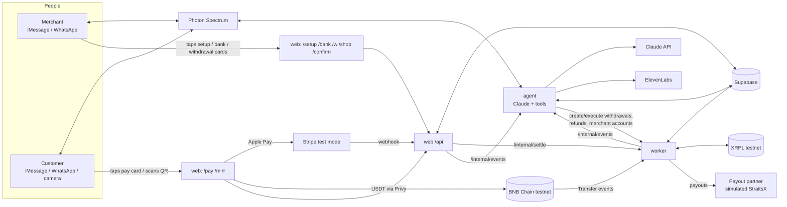
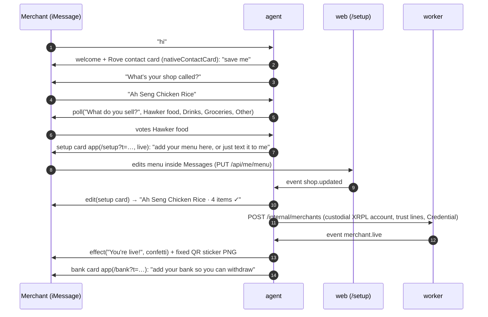
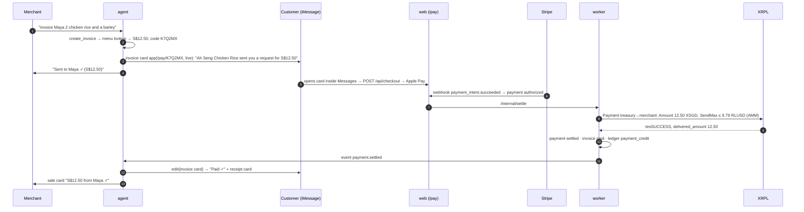
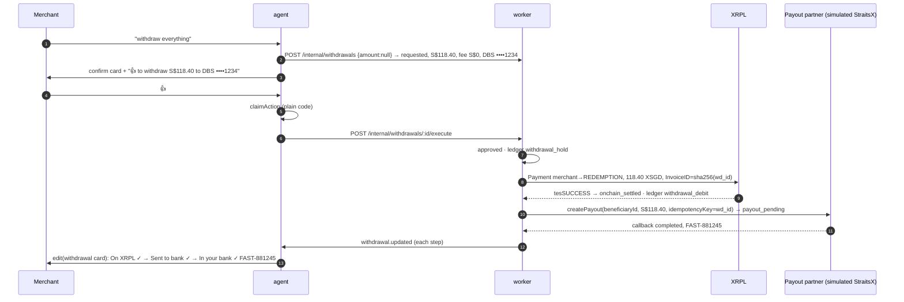

# 01 · Architecture

Three deployables, one database, two ledgers (XRPL for funds, Postgres for state). Each deployable has one owner.

| Deployable | Host | Owner | Why it's separate |
|---|---|---|---|
| `apps/web` (Next.js): the minimal web app + API | Vercel | Sahith (pages), Nithya (`/api/*` except actions), Saran (`/api/actions`) | Public HTTPS: Apple Pay, pages opened from messages |
| `apps/worker` | Railway | Nithya | Persistent XRPL + BSC connections; settlement, refunds, withdrawals |
| `apps/agent` | Railway | Saran (runtime, Claude, tools), Sahith (card presenter module) | Holds the Spectrum stream (iMessage + WhatsApp); long Claude turns |
| Supabase Postgres | Supabase | Nithya | State machines, ledger, menu, contacts, invoices |
| XRPL testnet | — | Nithya | Treasury, issuers, AMM, merchant custodial accounts, redemption account |
| BNB Chain testnet | — | Nithya | Test USDT, per-payment deposit addresses |

## System

Rules of the road:
- **Postgres is the source of truth for state; XRPL is the source of truth for funds.** The reconciler checks that ledger `available + held` = XSGD on each merchant's account.
- **Only the worker signs XRPL/BSC transactions** and calls Stripe refunds and the payout partner.
- **Only the agent talks to Photon.** Worker and web emit events; the agent turns them into messages.
- **Status changes are compare-and-set**, and every money handler is idempotent on a named key.
- **Bank numbers never enter the chat or our DB.** The bank form sends them to the payout partner; we keep `beneficiaryId` + last 4.

## Flow 1: merchant onboarding over iMessage (uses the iMessage App API)

WhatsApp merchants get the same steps as links and numbered replies (no polls, effects or in-place edits).

## Flow 2: invoice by text (merchant → customer)

A one-time QR is the same invoice rendered as a QR image for the merchant to show. A fixed QR is `/m/<shop>`: the customer picks items or types an amount, then the same checkout runs.

## Flow 3: withdrawal to bank (the pipeline; full spec in docs/specs/withdrawals.md)

## Flow 4: BNB Chain pay-in

`POST /api/checkout {method:"bnb"}` → per-payment deposit address → Privy wallet sends test USDT → worker sees `Transfer` (3 confirmations) → payment authorized → same settle step as Flow 2.

## Trust boundaries

| Boundary | Protection |
|---|---|
| Message sender → agent | Persona from the sender's phone; merchant tools only for that merchant's phone; customer tools see only invoices/receipts for that phone |
| Text from strangers (notes, names, contact cards, customer messages) | Data, never instructions |
| Agent → money | No tool moves money; `propose_*` → pending action → human 👍 / YES / card / web → plain-code executor |
| Withdrawals | Funds held in the ledger before anything leaves; first withdrawal, new bank, or > S$200 needs web step-up confirm |
| Bank details | Only on `/bank` (15-min token); sent to the partner; DB stores beneficiary id + last 4 |
| Merchant pages | HMAC session tokens with a scope (setup / bank / shop / withdrawal / sale), short expiry |
| Customer pages | Unguessable invoice codes and payment ids; amounts come from the server, never the URL |
| Stripe webhook | `constructEvent(rawBody)` + `claim("stripe:<id>")` |
| XRPL / BSC | Credit only `meta.delivered_amount`; per-payment deposit addresses; 3 confirmations; `claim()` per tx/log |
| Services | `authorization: Bearer INTERNAL_SECRET`, zod on every body |

## Environments

- **Local:** `pnpm dev` runs web :3000, worker :4001, agent :4002. Stripe CLI forwards webhooks. Photon's **terminal provider** lets you test the agent without a phone.
- **Deployed (from G3):** web on Vercel (stable HTTPS domain registered for Apple Pay), worker + agent on Railway, the same Supabase project.
