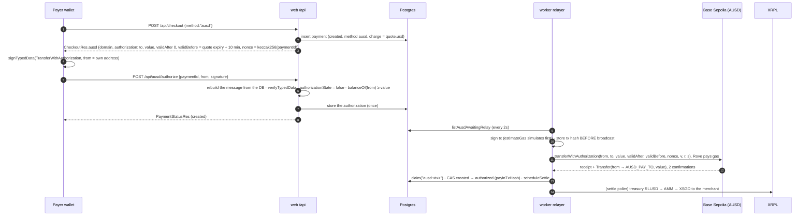

# Spec · AUSD lane: gasless stablecoin pay-in on Base Sepolia, plus x402 for agents

Owner: **Nithya** · Track: Agora "Best Use of AUSD" · Code: `apps/web/app/api/_lib/ausd.ts`, `apps/web/app/api/checkout/ausd.ts`, `apps/web/app/api/ausd/**`, `apps/web/app/api/x402/**`, `apps/worker/src/ausd/**`, `packages/db/src/repo/ausd.ts`, `apps/web/scripts/{ausd-*,x402-agent-pay}.ts`

## What and why

- **Tourists pay in a digital dollar without holding gas.** A customer with AUSD (Agora's fully reserved dollar, on 10+ chains) taps "Pay with AUSD", signs one EIP-712 message in their wallet, and is done. They need no ETH: the signature is an **ERC-3009 `TransferWithAuthorization`**, and Rove submits it and pays the gas.
- **AI agents pay merchants over HTTP.** A Rove invoice is also an **x402** resource: `GET /api/x402/invoices/<code>` answers `402 Payment Required` with machine-readable terms; an agent signs the same ERC-3009 authorization and retries; Rove verifies, relays and returns a receipt. The agent's wallet holds AUSD and no ETH.
- Same economics as the BNB lane (bnb-lane.md, payments-stripe.md §8): no card at all, so no card fees. The payer is charged `quote.usd` (AUSD is a dollar).

## The idea: float on each chain, settlement on XRPL (no bridge per payment)

```
Payer wallet / AI agent (Base Sepolia)        Rove                                        Merchant
  signs ERC-3009 TransferWithAuthorization ─►  web verifies + stores it
                                               worker relayer: transferWithAuthorization ─► AUSD lands at AUSD_PAY_TO (Rove's float)
                                               payment authorized ─► settle poller:
                                               XRPL treasury RLUSD ──AMM path payment──────► XSGD in the merchant's account
```

AUSD collects in Rove's Base float; the merchant is paid immediately from Rove's USD float on XRPL (`settle`, `from: "USD"`), exactly like the BNB lane. Floats are rebalanced in batches offline. Nothing bridges per payment.

## Flow 1: pay page (customer wallet)



The pay page UI (Sahith's) is not part of this lane's code: it needs a wallet (e.g. the Privy embedded wallet or any injected wallet) to call `signTypedData` with `CheckoutRes.ausd` and POST the result. Until then the lane is exercised by the x402 agent and the tests.

## Flow 2: x402 (an AI agent pays an invoice)

Protocol: **x402 v2** (coinbase/x402 `specs/x402-specification-v2.md`, `specs/transports-v2/http.md`, `specs/schemes/exact/scheme_exact_evm.md`). Self-facilitated: Rove verifies and settles; no third-party facilitator.

```mermaid
sequenceDiagram
  autonumber
  participant A as Agent (scripts/x402-agent-pay.ts)
  participant W as web /api/x402/invoices/:code
  participant R as worker relayer
  participant B as Base Sepolia
  A->>W: GET (no payment header)
  W-->>A: 402 + PAYMENT-REQUIRED (base64 PaymentRequired; same JSON in the body)
  A->>A: sign EIP-3009 for accepts[0] (random 32-byte nonce, validBefore = now + maxTimeoutSeconds)
  A->>W: GET + PAYMENT-SIGNATURE (base64 PaymentPayload)
  W->>W: requirements match · signed price offer valid · value == amount · to == payTo · signature · nonce unused · balance
  W->>W: insert ausd payment + authorization (one transaction)
  R->>B: transferWithAuthorization (as in Flow 1)
  W-->>A: 200 receipt JSON + PAYMENT-RESPONSE {success, transaction, network, payer, amount} (waits ≤ 30s; else 202, resend the same header)
```

The 402 body for invoice `K7Q2MX` (S$12.50 at the mock 1.29 → US$9.69):

```json
{
  "x402Version": 2,
  "error": "PAYMENT-SIGNATURE header is required",
  "resource": { "url": "https://<host>/api/x402/invoices/K7Q2MX", "description": "Ah Seng Chicken Rice · S$12.50", "mimeType": "application/json" },
  "accepts": [{
    "scheme": "exact", "network": "eip155:84532", "amount": "9690000",
    "asset": "0xa9012a055bd4e0eDfF8Ce09f960291C09D5322dC", "payTo": "<AUSD_PAY_TO>", "maxTimeoutSeconds": 600,
    "extra": { "assetTransferMethod": "eip3009", "name": "Agora Dollar", "version": "1", "roveQuote": "<signed offer>", "usd": "9.69", "local": "S$12.50" }
  }]
}
```

- **Price offer.** `extra.roveQuote` is the quote (local, USD, rate, expiry) HMAC-signed with `TOKEN_SECRET`, tied to the invoice id. The client echoes `accepted` back, so Rove charges exactly what it offered without writing anything for a 402 nobody pays. It is valid until the quote expiry + 10 minutes.
- **Headers.** v2 names (`PAYMENT-REQUIRED`, `PAYMENT-SIGNATURE`, `PAYMENT-RESPONSE`). The legacy `X-PAYMENT` request header is accepted with a v2 payload, and `X-PAYMENT-RESPONSE` mirrors `PAYMENT-RESPONSE`. `x402Version: 1` payloads get a 400 that says so.
- **Errors.** Malformed header → 400 `invalid_payment`. Verification failures → 402 with fresh requirements plus a `PAYMENT-RESPONSE` `{success:false, errorReason}` using the reference names (`invalid_exact_evm_payload_signature`, `…_authorization_value`, `…_recipient_mismatch`, `…_valid_before`, `…_nonce_used`, `insufficient_funds`, `invalid_network`, `unsupported_scheme`, `invalid_payment_requirements`, `quote_expired`). Relay failure → 402 `settlement_failed`. Invoice paid/expired/cancelled → 410. The same authorization reused for another invoice → 409.
- **Idempotent.** Resending the same `PAYMENT-SIGNATURE` returns the same payment's receipt; that's also how the agent polls after a 202.

## Contract

Already in `packages/shared` (unchanged by this lane): `"ausd"` in `CheckoutReq.method`, `PaymentMethod`, `PaymentStatusRes.method`; `CheckoutRes.ausd { chainId, token, decimals, amount, authorization {to, value, validAfter, validBefore, nonce}, domain }`; `AusdAuthorizeReq { paymentId, from, signature }`; `ROUTES.ausdAuthorize`.

| Route | Request → response | Errors |
|---|---|---|
| `POST /api/checkout {method:"ausd"}` | → `CheckoutRes` with `charge = quote.usd`, `ausd` | 409 `invoice_paid` / `payment_in_progress`, 503 `ausd_not_configured` |
| `POST /api/ausd/authorize` | `AusdAuthorizeReq` → `PaymentStatusRes` | 400 `invalid_address` / `invalid_signature_format` / `invalid_signature` · 404 · 409 `wrong_method` / `payment_not_open` / `already_authorized` / `authorization_used` / `authorization_reused` / `invoice_paid` · 410 `quote_expired` · 422 `insufficient_funds` · 503 `chain_unavailable` |
| `GET\|POST /api/x402/invoices/:code` | x402 v2 (above) | above |

DB (additions only, `packages/db`): `setAusdAuthorization`, `insertAusdPayment`, `getAusdRelay`, `getPaymentByAusdNonce`, `listAusdAwaitingRelay`, `setAusdRelayTx`; columns `payments.ausd_{from,to,value,valid_after,valid_before,nonce,signature,relay_tx_hash,relay_attempts}` (uint256s as `numeric(78,0)`), unique `(lower(ausd_from), lower(ausd_nonce))` (one authorization pays one payment) and unique relay tx hash. The confirmed relay tx goes in the existing `payin_tx_hash`.

## Verified token facts (Base Sepolia, chainId 84532)

Read with viem on 2026-10-11 (`apps/web/scripts/ausd-inspect.ts`, `ausd-simulate.ts`; reproducible without keys).

| Fact | Value | Source |
|---|---|---|
| Token address | `0xa9012a055bd4e0eDfF8Ce09f960291C09D5322dC` | [Agora docs: Contract Deployments → Testnet → Base Sepolia](https://docs.agora.finance/developer/contract-deployments); code present on-chain (proxy, EIP-1967 implementation `0xc1e3c7d4…12da`) |
| `decimals()` | `6` | on-chain read |
| `name()` / `symbol()` | `"AUSD"` / `"AUSD"` | on-chain read |
| **EIP-712 domain** (`eip712Domain()`) | name **`"Agora Dollar"`** (not the ERC-20 name), version **`"1"`**, chainId 84532, verifyingContract = token | on-chain read; `DOMAIN_SEPARATOR()` `0x5a85328c…e8bb` equals our computed separator (asserted in `_lib/ausd.test.ts`) |
| `version()` | returns a struct (2, 1, 0): the implementation version, **not** the EIP-712 version | on-chain read |
| ERC-3009 | `transferWithAuthorization` in both `(…, v, r, s)` (`0xe3ee160e`) and `(…, bytes signature)` (`0xcf092995`); `receiveWithAuthorization`, `cancelAuthorization`, `authorizationState(address,bytes32)`; `TRANSFER_WITH_AUTHORIZATION_TYPEHASH()` = keccak of the standard EIP-3009 struct | selectors found in the implementation bytecode; typehash read on-chain; [Agora docs: Advanced ERC Features](https://docs.agora.finance/developer/advanced-erc-features) |
| Signature accepted by the real contract | an `eth_call` of `transferWithAuthorization` with value 0 signed by our code **succeeds**; the same signature with value 1 reverts `0x8baa579f` (invalid signature); a correct 1 AUSD authorization from an empty wallet reverts `ERC20InsufficientBalance` (`0xe450d38c`) | `apps/web/scripts/ausd-simulate.ts` |
| Pause flags | `isTransferPaused()` false, `isSignatureVerificationPaused()` false | on-chain read |
| Faucet | `0xd236c18D274E54FAccC3dd9DDA4b27965a73ee6C`, `requestFunds(address to)`: 10,000 AUSD per call, global rate limit 60s (`MaxFrequencyExceeded`), max 100,000 AUSD per holder; **the caller pays gas** | [Agora docs: Getting Testnet Tokens](https://docs.agora.finance/instant-settlement/guides/getting-testnet-tokens); `maxDripFrequency()`, `faucetDripAmount()`, `maxAmountToOwn()` read on-chain |

## Relayer (worker) and safety

- Only the worker signs (`AUSD_RELAYER_PRIVATE_KEY`, never on Vercel). The web is read-only (`balanceOf`, `authorizationState`).
- One step per tick per payment: **no tx** → refuse if expired, if `authorizationState` is already true (used or cancelled outside Rove: we can't prove the AUSD reached us), or if the invoice is paid/being paid another way; else sign (estimateGas simulates first), **record the hash, then broadcast**. **Tx recorded** → receipt success with the exact `Transfer(from → AUSD_PAY_TO, value)` and 2 confirmations → `claim("ausd:<hash>")` → CAS `created → authorized` (`payinTxHash`) → `scheduleSettle`. Pending → wait; unseen for 60s or reverted → sign again (≤ 5 attempts) while `authorizationState` is false.
- Crash-safe and idempotent: the hash is stored before broadcast, so a restarted worker finds its own tx; ERC-3009 nonces are one-shot on-chain, so a second relay can't move money twice.
- Invoice paid by card while AUSD was in flight → `payments_one_per_invoice` rejects the CAS → payment `failed` with a manual AUSD refund note (like bnb: token refunds are a logged manual step).
- Settlement failures after `authorized` follow settle.ts: token lanes get "refund pending review" instead of a Stripe refund.

## Env

`BASE_SEPOLIA_RPC_URL` (default `https://sepolia.base.org`), `AUSD_TOKEN_ADDRESS`, `AUSD_DECIMALS`, `AUSD_PAY_TO` (public; empty = lane off), `AUSD_RELAYER_PRIVATE_KEY` (worker only), `X402_AGENT_PRIVATE_KEY` (demo script only), optional `AUSD_RELAY_POLL_MS`. `scripts/ausd-keygen.ts` writes fresh testnet keys to `.env.ausd` (mode 600, gitignored) and prints only addresses.

## Demo

1. Keys: `pnpm --filter web exec tsx scripts/ausd-keygen.ts`; copy `.env.ausd` lines into `.env` (`AUSD_RELAYER_PRIVATE_KEY` only where the worker runs).
2. Fund the **relayer** with a little Base Sepolia ETH. A human does this: public faucets need a sign-in or captcha (e.g. the Coinbase Developer Platform faucet, https://portal.cdp.coinbase.com/products/faucet, network Base Sepolia). A few hundredths of an ETH covers hundreds of relays.
3. Mint AUSD to the **agent**: `pnpm --filter web exec tsx scripts/ausd-faucet.ts` (the relayer pays the faucet call's gas; 10,000 AUSD per call).
4. `pnpm dev` (web + worker), merchant texts "invoice Maya 2 chicken rice and a barley" → code `K7Q2MX`.
5. `pnpm --filter web exec tsx scripts/x402-agent-pay.ts K7Q2MX` → prints the 402 terms, then the receipt and the Basescan link; the merchant gets the usual sale card when XRPL settles.
6. Proof without funds: `scripts/ausd-simulate.ts` (the contract accepts our signatures) and `scripts/ausd-inspect.ts <addresses>` (token facts and balances).

## Real vs simulated

| Piece | Demo |
|---|---|
| AUSD token, ERC-3009, Base Sepolia | **Real** (Agora's testnet AUSD; faucet tokens, not reserves) |
| Gasless payer: Rove relays and pays gas | **Real** relayer, testnet ETH |
| x402 v2 protocol, headers, payloads | **Real**, self-facilitated (no Coinbase facilitator) |
| Rove's AUSD float → XRPL USD float rebalancing | Not built: floats are rebalanced offline in batches (as in the BNB lane) |
| Merchant settlement on XRPL | Same as every lane (real XRPL testnet, or the mock engine) |
| AUSD refunds (failed or double-paid invoices) | Manual, logged (like bnb) |

## Known gaps

- No pay-page button yet (Sahith's page): it needs a wallet `signTypedData` + POST to `/api/ausd/authorize`.
- EOA payers only: signatures are checked with ECDSA recovery and relayed through the `(v, r, s)` entry point. Smart-contract wallets (ERC-1271) would need the bytes-signature entry point and an on-chain `isValidSignature` check.
- The web waits up to 30s inside the x402 request for the relayer (`maxDuration` 60). On a host with a shorter function timeout, lower the wait; the 202 + resend path already covers it.
- A third party may relay a valid authorization before Rove does (the funds still arrive at `AUSD_PAY_TO`); the relayer then fails the payment with `authorization_used_elsewhere` rather than credit something it can't tie to its own tx, and logs it for manual review.
